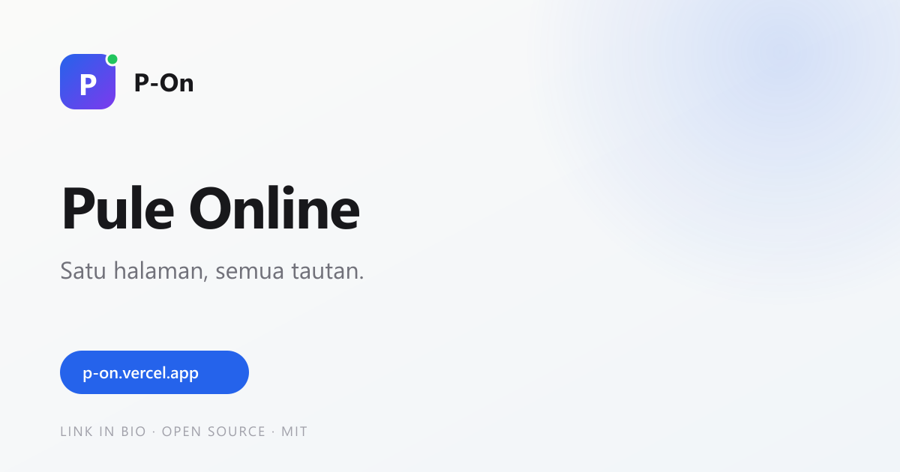

# P-On

**A fast, minimal, open-source link-in-bio page.**
One config file, your own domain, no subscription, no watermark.

[](./LICENSE)
[](https://nextjs.org)
[](https://tailwindcss.com)



> Live demo: `https://pulzzz06.vercel.app` — domain sementara sampai kamu punya domain custom.

---

## Why another link-in-bio?

- **Yours.** No account, no tracking, no branding from a third party.
- **Fast.** One static page, minimal JavaScript, system-aware dark mode.
- **Easy to fork.** All content lives in one typed file: `config/site.ts`.
- **Portable.** Deploy to Vercel, Netlify, Cloudflare Pages, or GitHub Pages.

---

## Features

- Profile: avatar, name, handle, headline, bio, location, availability badge
- Social icons (GitHub, Instagram, X, LinkedIn, YouTube, TikTok, email)
- Featured link cards + grouped links
- GitHub project showcase with language colors and stars
- Light / dark / system theme with one accent color
- Share button (Web Share API + clipboard fallback)
- SEO metadata, JSON-LD, Open Graph image, favicon
- Accessible focus states and reduced-motion support
- Static export support for free hosting anywhere

---

## Quick start

```bash
git clone https://github.com/Pulzzz06/p-on.git
cd p-on
npm install
npm run dev
```

Open <http://localhost:3000>.

Then edit **`config/site.ts`** — that is the only file you need to change.

---

## Make it yours

| What | Where |
|---|---|
| Name, handle, bio, avatar | `config/site.ts` → `profile` |
| Page title, description, URL | `config/site.ts` → `meta` |
| Social links | `config/site.ts` → `socials` |
| Main links | `config/site.ts` → `links` |
| Grouped links | `config/site.ts` → `groups` |
| GitHub projects | `config/site.ts` → `projects.items` |
| Accent color, theme mode | `config/site.ts` → `theme` |
| Avatar image | `public/avatar.jpeg` |
| Social preview image | `public/og.png` |
| Favicon | `app/icon.svg` |

### Add a link

```ts
{
  id: "newsletter",
  label: "Newsletter",
  description: "Catatan mingguan tentang frontend",
  url: "https://example.com/newsletter",
  icon: "mail",
  badge: "Baru",
}
```

### Add a project

```ts
{
  repo: "my-project",
  name: "My Project",
  description: "A short description of what it does.",
  language: "TypeScript",
  stars: 12,
  url: "https://github.com/username/my-project",
  demo: "https://my-project.vercel.app",
}
```

Set `visible: false` to hide a link without deleting it. Set `featured: true` to make a link card use the accent background.

---

## Theming

The default preset is **stone** with a blue accent. Change it in `config/site.ts`:

```ts
theme: {
  preset: "stone",
  mode: "system",   // "light" | "dark" | "system"
  accent: "#2563EB",
  font: "jakarta",
  radius: "md",
  background: "plain",
}
```

The accent color is applied through CSS variables, so one change updates
buttons, icons, focus rings, and the featured card.

Regenerate the placeholder avatar and OG image after changing the brand:

```bash
npm run assets
```

---

## Deploy

### Vercel (recommended)

[](https://vercel.com/new/clone?repository-url=https://github.com/Pulzzz06/p-on)

Import the repo, keep the defaults, and deploy. Add your custom domain in
**Project → Settings → Domains**, then update `meta.url`.

### Netlify

- Build command: `npm run build`
- Publish directory: `.next` (Netlify's Next.js runtime handles it)

### Cloudflare Pages

- Framework preset: **Next.js**
- Build command: `npm run build`

### GitHub Pages (static export)

```bash
STATIC_EXPORT=1 npm run build
```

Upload the `out/` folder to any static host. If the site lives at
`https://username.github.io/p-on`, set the base path at build time:

```bash
STATIC_EXPORT=1 NEXT_PUBLIC_BASE_PATH=/p-on npm run build
```

On Windows PowerShell:

```powershell
$env:STATIC_EXPORT="1"; $env:NEXT_PUBLIC_BASE_PATH="/p-on"; npm run build
```

> Static export uses unoptimized images and a static OG image. That is expected.

---

## Scripts

| Command | Description |
|---|---|
| `npm run dev` | Start the development server |
| `npm run build` | Production build |
| `npm run start` | Serve the production build |
| `npm run lint` | Run ESLint |
| `npm run typecheck` | Run TypeScript without emitting |
| `npm run assets` | Regenerate `public/avatar.png` and `public/og.png` |

---

## Project structure

```text
app/                 Routes, layout, metadata, global styles
components/          UI components
config/site.ts       Your content — edit this
lib/                 Types, icons, theme helpers
public/              Avatar and OG image
scripts/             Asset generator
```

---

## License

MIT © Pule Online. See [LICENSE](./LICENSE).

---

## Bahasa Indonesia

Ringkasan cepat:

1. `npm install`
2. Ubah `config/site.ts` (profil, sosial, link, proyek, tema).
3. `npm run dev` untuk melihat hasilnya.
4. Deploy ke Vercel, atau `STATIC_EXPORT=1 npm run build` untuk hosting statis.

Tidak perlu database, login, atau langganan. Semua konten ada di satu file.
